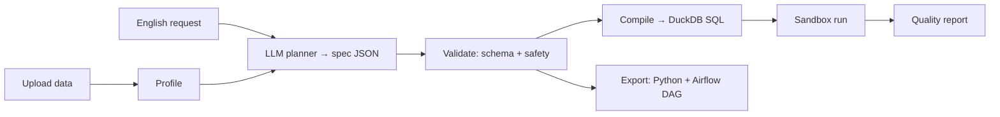

<div align="center">

# PipelineCopilot

**AI data-engineering SaaS: describe a pipeline in plain English, review a validated spec, run it in a sandbox, export production code.**

[](https://github.com/divithraju/pipeline-copilot/actions)
[](LICENSE)
  

### 🚀 [**Open the Live Demo**](https://divithraju.github.io/pipeline-copilot/)
*Runs entirely in your browser (DuckDB-WASM). Pick a preset, edit the spec, run it, export the code.*

</div>

## Author
**Divith Raju** — AI Engineering Team Lead · EX-Data engineer · LinkedIn Top Voice in Data Engineering
GitHub [@divithraju](https://github.com/divithraju) · Open-source: [`friendlyetl`](https://pypi.org/project/friendlyetl/)

## The problem
Routine data transformations (dedupe, clean, filter, aggregate) consume engineering time. Generic AI code assistants write code nobody has reviewed, which teams rightly refuse to run on production data.

## The approach
**The AI never writes executable code.** It writes a small declarative **pipeline spec** (JSON). Everything after that is deterministic and testable:



| Feature | Detail |
|---|---|
| Spec language | `filter`, `select`, `rename`, `cast`, `derive`, `dedupe`, `aggregate` |
| Validation | pydantic models; identifier regex; expressions reject `;`, comments, subqueries, DDL/DML, file and network functions |
| Sandbox | File loaded first, then DuckDB external access and configuration are locked; memory and threads capped |
| Repair loop | Invalid LLM output is fed back once for correction |
| Quality report | Rows in/out, % dropped, null rates, leftover duplicates, warnings |
| Export | Standalone Python script (DuckDB → Parquet) and an Airflow DAG |
| UI | Upload, describe, edit spec, run, view SQL and preview, export. Full app (`web/`) or the browser-only [live demo](https://divithraju.github.io/pipeline-copilot/) (`docs/index.html`, preset specs, no backend) |

## Quick start
```bash
git clone https://github.com/divithraju/pipeline-copilot.git
cd pipeline-copilot
python -m venv .venv && source .venv/bin/activate
pip install -r requirements.txt
cp .env.example .env            # add ANTHROPIC_API_KEY to enable "Generate spec"
export $(grep -v '^#' .env | xargs)
uvicorn app.main:app --reload
# open http://localhost:8000
```
No API key? Click **Load example spec**, then **Run on sandbox**: everything except spec generation works offline.

Docker: `docker build -t pipeline-copilot . && docker run -p 8000:8000 --env-file .env pipeline-copilot`

## Live demo vs full app
| | Live demo (GitHub Pages) | Full app (`uvicorn`) |
|---|---|---|
| Engine | DuckDB-WASM in your browser | DuckDB on the server |
| Data | Sample or your CSV, never uploaded | Upload to your own server |
| AI spec generation | Preset specs only | Yes, with `ANTHROPIC_API_KEY` |
| Validation, compiler, quality report, code export | Same logic (verified to produce identical SQL) | Reference implementation |

Note: the `rename` step moves renamed columns to the end of the table; add a `select` step to reorder.

## Example
Request: *"Remove duplicate orders, keep completed ones, and show monthly revenue by country."*

```json
{"name":"monthly_revenue","source":{"path":"examples/orders.csv","format":"csv"},"steps":[
 {"type":"dedupe","keys":["order_id"]},
 {"type":"filter","expr":"lower(status) = 'completed' AND amount IS NOT NULL"},
 {"type":"derive","name":"month","expr":"strftime(CAST(order_date AS DATE), '%Y-%m')"},
 {"type":"aggregate","group_by":["country","month"],
  "metrics":[{"name":"revenue","expr":"sum(amount)"},{"name":"orders","expr":"count(*)"}]}]}
```

## API
| Endpoint | Purpose |
|---|---|
| `POST /api/upload` | Upload a file, get its profile |
| `POST /api/plan` | English request → validated spec |
| `POST /api/run` | Run a spec in the sandbox → preview, SQL, quality report |
| `POST /api/codegen` | Spec → Python script + Airflow DAG |

## Testing
```bash
DATA_DIR=data pytest -q
```
15 tests cover compilation, dedupe correctness, unsafe-expression rejection, path traversal, the planner repair loop, the API, and runnable generated code.

## Status
| Component | Status |
|---|---|
| Spec, compiler, sandbox, quality report, codegen, UI | ✅ Working, tested |
| Planner accuracy benchmark | 🔧 Planned ([ROADMAP](docs/ROADMAP.md)) |
| Joins, scheduling, auth, warehouse sources | 🔧 Planned |

**Known limits:** single-table pipelines; no statement timeout yet (run in a resource-limited container in production). See [`docs/ARCHITECTURE.md`](docs/ARCHITECTURE.md).

## Docs
[Architecture](docs/ARCHITECTURE.md) · [Product definition](docs/PRODUCT.md) · [Roadmap](docs/ROADMAP.md)

## License
MIT. See [LICENSE](LICENSE). © 2026 **Divith Raju**, AI Engineer Team Lead.
