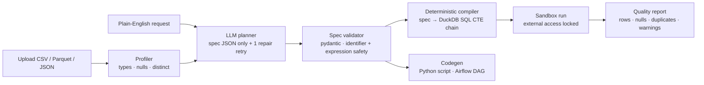

# Architecture

## Key design decisions
1. **The LLM never writes executable code.** It emits a small declarative spec (filter, select, rename, cast, derive, dedupe, aggregate). A deterministic compiler produces the SQL, so behaviour is reviewable and testable.
2. **Defence in depth for expressions.** Identifiers are regex-checked; expressions reject statement separators, comments, subqueries, DDL/DML, file/network functions. The source file is loaded *first*, then DuckDB `enable_external_access=false` and `lock_configuration=true` are set, so even a missed pattern cannot read other files or the network.
3. **Repair loop.** If the model returns an invalid spec, the validation error is fed back once.
4. **Quality gates before trust.** Every run reports rows in/out, null rates and leftover duplicates, with warnings.
5. **Human in the loop.** The spec is shown and editable before it runs.

## Known limits (be honest in interviews)
- Single-table pipelines only (no joins yet).
- The denylist is a first line of defence; production deployments should also run the engine in a container with CPU/memory/time limits (memory and threads are capped, but there is no statement timeout yet).
- Planner quality is not yet benchmarked; see ROADMAP for the eval plan.
